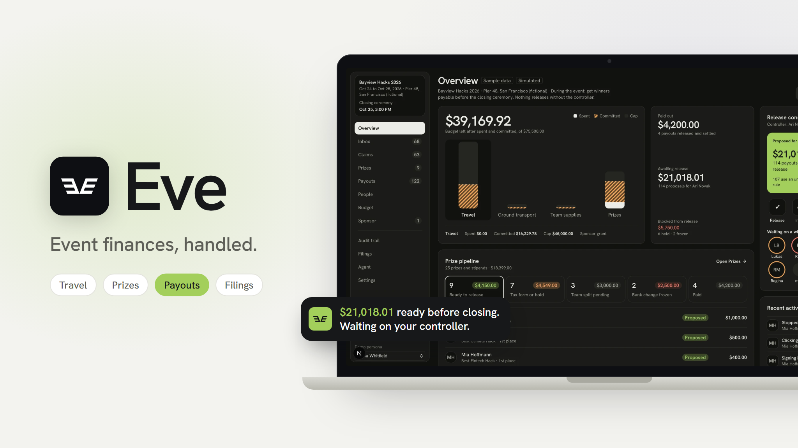
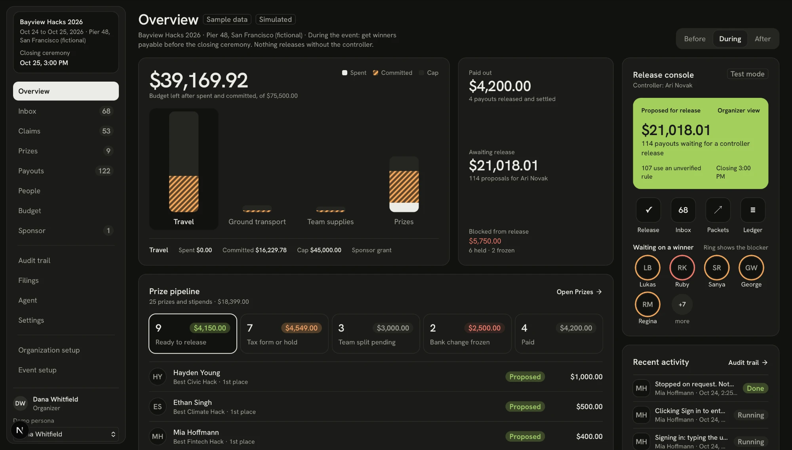

# Eve



Eve is an event finance agent that runs the money side of a hackathon: travel reimbursements, expenses, cash and physical prizes, and the cross-border tax work behind them. Organizers set budgets and rules, attendees submit receipts and claim prizes in a portal, and Eve prepares every payout with its evidence. Nothing is released without a human controller.

Money movement is **simulated**. Tax documents are **drafts, not for filing**. Product scope is in [PRD.md](PRD.md), the Daylight interface in [DESIGN.md](DESIGN.md), and integration and validation details in [IMPLEMENTATION.md](IMPLEMENTATION.md).

## Inspiration

Evan won a prize at TreeHacks. The organizers first tried to ship the physical prize, then found they couldn't for tax reasons, because he's a Canadian citizen. They switched to a wire. Getting the right tax form, the right withholding and a working international transfer took about nine months.

Nobody did anything wrong. The organization simply had no system that knew, at the moment he won, that a Canadian winner needs a W-8BEN, a withholding decision and a cross-border payout rail. The same failure repeats at every event: receipts in other currencies, caps nobody checks until after the flight is booked, tax forms collected late, and a university or fiscal sponsor that holds the bank account.

We asked: what if one permissioned agent did the travel coordinator's, accounts payable clerk's and tax preparer's jobs, while a human still decides when money moves?

## What it does

- **Overview for organizers.** Budget left, payouts awaiting release, what is blocked and why, and the prize pipeline before the closing ceremony.

  

- **Travel and expenses.** Policy-aware flight suggestions, receipt reading, caps, currency conversion, duplicate and fare-anomaly checks.
- **Cash and physical prizes.** For each item prize, Eve compares shipping, buying locally and a cash equivalent. Team splits need member confirmation.
- **Tax profiles and withholding.** Adult-only onboarding collects residency and W-9 or W-8BEN details; withholding, fees and FX are computed before approval.
- **Controller release.** Every proposal discloses gross, withholding, fees and expected net. Only the controller can release it; the organizer and the agent cannot.
- **Fraud guards.** Claimed fares are compared with peers and stored market prices, travel claims from hackers with no project on record are escalated, and a bank change near payout freezes the payment until it is confirmed through the original contact channel.
- **Slack approvals.** Controllers approve by DM; organizers get channel alerts and digests.
- **Fiscal sponsor handoff.** Sponsor packets, remittance reconciliation, and computer use that fills a sponsor portal and stops before Submit.
- **Audit and filings.** An immutable double-entry ledger, decision evidence behind every number, accounting exports and filing drafts.

## How we built it

**Frontend:** Next.js 16 App Router, React 19, TypeScript, Tailwind CSS 4, shadcn/ui, Base UI, TanStack Table, lucide icons.

**Backend:** server actions and route handlers, Postgres (PlanetScale) with Drizzle ORM, Better Auth, Zod, Vercel Workflow for durable jobs and cron, pdf-lib for documents.

**AI:**

- Claude through the Vercel AI SDK and Anthropic SDK for receipt reading with structured extraction and for the event review agent
- Claude computer use on an E2B desktop to enter sponsor packets
- Deterministic policy, tax and money engines; the model never decides an amount

**Dev tools:** pnpm, Vitest, ESLint, Drizzle Kit, Vercel.

## Challenges we ran into

- **Autonomy without a superuser.** The agent is a role with permissions enforced in code, not in the prompt. It can propose and hold, never release.
- **Sources that disagree.** Receipts, card charges, policy, the sponsor's ledger and the payee's bank each say something slightly different, and Eve has to say which to trust and why.
- **Cross-border tax.** Cumulative per-payee thresholds, default 30% withholding without a valid treaty claim, and Canadian rules we kept explicitly unverified instead of guessing.

## Accomplishments we're proud of

- A seeded 300-person event where the measured scoreboard caught 40 of 40 planted problems, with no false positives and no wrongful payouts ([benchmark](docs/demo-benchmark.json))
- A balanced, immutable ledger where every number can be traced to its decision record
- Computer use that fills a real-looking sponsor portal end to end and leaves the final Submit to a person

## What we learned

The hard part of a finance agent isn't the model; it's deciding what the model is allowed to do. Keeping calculations deterministic, rules versioned and release with a human let us automate the routine work without trusting generation with money.

## What's next

- Live payment rails beyond test mode, and verified Duffel flight booking
- Verified Canadian rules and treaty handling
- Official IRS and CRA forms and e-filing
- Email verification and invitation delivery for real organizations

## Individual contributions

- **Evan**: Product and architecture, the ledger, tax, payout and policy engines, receipt reading, the agent and workflows, sponsor packets and disbursement batches, the attendee portal, browser QA and deployment
- **Bernice**: The Eve Slack app (approvals by DM, channel alerts and digests), computer use on the sponsor portal, the Lamplight dark theme and Overview layout
- **Uijin**: Airfare fraud detection (peer fare anomalies, market price snapshots, nightly cheapest-fare tracking), attendee verification against project submissions, the Daylight theme and Overview home

## Live demo

Open the [Vercel preview](https://eve-calhacks-bnzqx9gf8-badbird5907s-projects.vercel.app) with your Vercel account. The [overnight handover](docs/overnight-handover.md) contains the walkthrough and remaining limitations; the [browser QA index](docs/browser-qa-summary.md) links the tested journeys, fixes and evidence.

## Run locally

Use Node 24 and pnpm 11. Install with `pnpm install --frozen-lockfile`. Copy `.env.example` to `.env.local` and set the database URLs, auth secret and vault key. Receipt reading additionally needs the Anthropic key. Never commit an environment file or replace an existing vault key: saved identifiers depend on it.

```sh
pnpm db:migrate
pnpm seed
pnpm dev
```

Open <http://localhost:3000>. Migrations use the direct Postgres connection with TLS verification; normal traffic uses the pooled connection. The default seed is a fictional 60-person event with 15 release-ready payments: seven reimbursements (flights, ground transport, baggage and supplies) and eight prizes, spanning US and international recipients. It also includes blocked and pending cases for the live review. It does not create real payments or send external notifications.

Use `pnpm seed --reset` (or Reset demo in the app) to replace the shared sample with this smaller dataset. Existing samples are not changed automatically. The original 300-person benchmark is available with `pnpm seed --reset --benchmark`; `pnpm verify:demo --reset` also uses that larger dataset.

With `EVE_DEMO_MODE=true`, `/login` offers sample organizer, controller, auditor and attendee personas. Anonymous demo visitors enter as the sample organizer. The attendee portal is `/portal`; the organizer home is `/overview` (`/` redirects there) and the inbox is `/inbox`. Disable demo mode for a private installation. Real-account onboarding and invitation endpoint contracts are in [ONBOARDING.md](lib/server/ONBOARDING.md).

## What to try

1. Open **Prizes**, inspect Priya's MacBook recommendation and choose its cash equivalent.
2. Switch to Priya's attendee persona and complete her profile and W-8BEN. The unresolved treaty claim should stay off for the default-withholding example.
3. Inspect the persisted gross, withholding, fees and net. Switch to the controller to release the proposal. The organizer and agent cannot release it.
4. Inspect the decision evidence, payout status and ledger export. Generate filing drafts from **Filings**.
5. Inspect Jordan's frozen bank change. Verification belongs to the original contact channel; confirming it still requires a fresh controller release.
6. Run the event review in **Agent** and inspect the measured scoreboard. It shows the last evaluated run, with its timestamp; later interactions change the next run's result. The demo reset clears only the fictional organization.

A real attendee can enroll their first simulated payout account in the portal. Replacing an account, or entering one as staff, requires confirmation through the original email; without a configured email provider, that change remains frozen. Importing adult attendees starts tax-form reminders; organizers share the portal invitation links from People.

The shared sample event may already contain completed demo actions. Reset only when nobody else is using it. Real organizations are excluded from reset.

## Checks

```sh
pnpm lint
pnpm typecheck
pnpm test
pnpm build
```

Database tests use disposable organizations in the configured Postgres database and remove them afterwards; they skip when no database is configured. They test balance, immutability, period locks, access boundaries and business flows. `typecheck` runs Next's route type generation first.

With the local server running, `pnpm verify:workflow` exercises the real HTTP route, durable background proposals, controller hooks and duplicate-release behavior against an isolated synthetic organization. `pnpm verify:ocr` makes a paid Anthropic API request using a synthetic receipt; it is separate from the ordinary test suite.

`pnpm verify:demo --reset` rebuilds the shared fictional event, runs its durable review, explicitly releases the two threshold-crossing payments as the sample controller, generates drafts, and saves the measured scoreboard to `docs/demo-benchmark.json`. It takes several minutes. Coordinate before using `--reset`: it replaces the shared demo's interactions, while leaving real organizations alone. Without `--reset`, it measures the current demo state.

## External services and outputs

| Area | Current path |
| --- | --- |
| Payments | Simulated wire provider. The separate Stripe adapter accepts test credentials only; verifying the platform credential does not prove recipient settlement. |
| Receipt reading | Claude vision with structured extraction. Policy and money calculations remain deterministic. Missing or uncertain facts require review. |
| Flights | Labeled fixture inventory; Duffel test adapter exists but has not been verified with an account. |
| FX and fulfillment | Seeded reference-rate and shipping/duty estimates. These are demo inputs, not live quotes. |
| Accounting | Balanced journal CSV, account mapping and import manifest for the documented QuickBooks fallback. See [import instructions](lib/accounting/README.md). |
| Notifications | Persisted portal notices and simulated delivery by default. Optional email/Slack/Discord adapters require configuration and an explicit live-delivery switch. |
| Slack app | Approvals by DM with buttons, channel alerts batched every 15 minutes, daily and end-of-weekend digests, event-weekend countdown. Off until the Slack app credentials are set and an organizer connects a workspace; then it posts for that organization, including the sample one. See [Slack app](docs/slack.md). |
| Invitations | Copyable, expiring, single-use links. No invitation email is sent. Accounts do not yet require email verification. |
| Tax output | Signature receipts, filing worksheets, sponsor PDFs and annual 1042 reconciliation summary. Custom drafts, not official IRS/CRA forms or e-filing submissions. |

Rule versions, sources and unresolved jurisdiction questions are recorded in [tax sources](lib/tax/SOURCES.md). Canadian rules and the proposed Canada treaty treatment remain explicitly unverified. The deterministic engine's decisions do not establish filing compliance.

## Deployment and jobs

The Vercel project is `eve-calhacks`. Preview deployments use the CLI; GitHub automatic deployment is not linked. Configure environment variables privately in the project's Preview environment and run migrations before deployment. Do not include `.env*`, workflow state or local browser artifacts in a deployment upload; `.vercelignore` excludes them.

`vercel deploy` creates a preview. `BETTER_AUTH_URL` may be omitted there so auth uses the deployment's `VERCEL_URL`. A local custom port needs a matching `BETTER_AUTH_URL`.

See [workflow operations](workflows/README.md) for triggers, reminders and recovery. Vercel's configured daily cron runs on production deployments; a Preview needs a manual authenticated `/api/cron` invocation to exercise that sweep. Durable jobs started by an action run on the Preview itself.

Eve can enter a drafted sponsor packet on a fictional sponsor portal with computer use (E2B desktop and Claude), stopping before the final Submit for a controller; see [computer use](docs/computer-use.md), including a standalone lab at `/lab/computer-use`. Real tax filing is outside the shipped demo scope. See [requirement coverage](docs/requirement-coverage.md) for the completed behavior and boundaries of each workflow.
